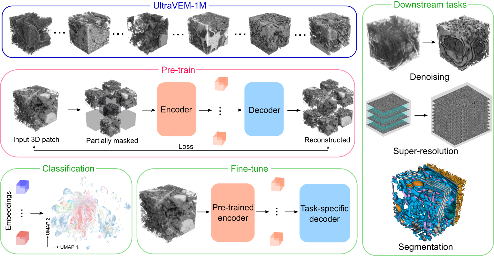

# UltraVEM

Code accompanying a manuscript describing UltraVEM: a 3D foundation model for volume
electron microscopy (vEM), built by self-supervised masked-autoencoder (MAE) pre-training
on a large corpus of vEM volumes, then adapted to downstream image-restoration and
analysis tasks by fine-tuning task-specific decoders on the shared pre-trained encoder.

*Schematic of the UltraVEM workflow: self-supervised 3D masked-autoencoder pretraining on
UltraVEM-1M, evaluation of the resulting 3D image embeddings by clustering and
classification, and fine-tuning of task-specific decoders (denoising, super-resolution,
segmentation) on the shared pretrained encoder.*

---

## Demo notebooks

The quickest way to check that the code actually runs end-to-end — installation through a
trained checkpoint to a visualized result — is the runnable demo notebook in each fine-tuning
task, without needing our cluster or full training runs:

- [`UltraVEM_DN/ultravem_DN_demo.ipynb`](UltraVEM_DN/ultravem_DN_demo.ipynb) — denoising
- [`UltraVEM_SR/ultravem_SR_demo.ipynb`](UltraVEM_SR/ultravem_SR_demo.ipynb) — super-resolution
- [`UltraVEM_Seg/ultravem_Seg_demo.ipynb`](UltraVEM_Seg/ultravem_Seg_demo.ipynb) — segmentation

Each notebook: loads a pre-trained checkpoint into the task network and sanity-checks the
forward pass, converts a small set of volumes into the expected data layout, shows the
exact training and inference commands, and renders the model's output next to the input
(and ground truth, where applicable).

---

## Repository map

Each stage of the pipeline lives in its own self-contained directory, so a reader who only
cares about one stage does not need to pull in the others.

| Directory | Stage | What's in it |
|---|---|---|
| [`nnssl/`](nnssl/) | 1. Pre-training | Fork of [nnssl](https://github.com/MIC-DKFZ/nnssl) — self-supervised MAE pre-training of the shared 3D encoder on the UltraVEM-1M corpus. SLURM scripts, dataset conversion, multi-node training. |
| [`classification/`](classification/) | 2. Embedding evaluation | Extracts embeddings from a pre-trained encoder and evaluates them with k-NN / linear-probe classification and data-efficiency curves against organism / tissue / modality labels. |
| [`UltraVEM_DN/`](UltraVEM_DN/) | 3. Fine-tuning — denoising | Self-supervised denoising decoder (synthetic Poisson-Gaussian noise, residual on a Gaussian baseline), built on nnU-Net. |
| [`UltraVEM_SR/`](UltraVEM_SR/) | 3. Fine-tuning — super-resolution | Anisotropic super-resolution decoder (synthetic per-axis degradation), built on nnU-Net. |
| [`UltraVEM_Seg/`](UltraVEM_Seg/) | 3. Fine-tuning — segmentation | Fully-supervised semantic segmentation, standard nnU-Net, optionally warm-started from the pre-trained encoder. |
| [`nnUNet/`](nnUNet/) | (shared dependency) | Fork of [nnU-Net v2](https://github.com/MIC-DKFZ/nnUNet) holding the denoising and super-resolution trainers/inference scripts used by `UltraVEM_DN` and `UltraVEM_SR`, plus stock nnU-Net for `UltraVEM_Seg`. |

`nnssl` and `nnUNet` are the two frameworks the rest of the tree depends on; `classification`,
`UltraVEM_DN`, `UltraVEM_SR` and `UltraVEM_Seg` are the four things a reader actually runs.
Each directory has its own `README.md`/`readme.md` with installation, data-layout and usage
instructions specific to that stage — start there for anything beyond this overview.

---

## Workflow

1. **Pre-train** the shared 3D encoder with a masked-autoencoder objective on UltraVEM-1M
   (`nnssl/`).
2. **Evaluate** the resulting embeddings directly — no fine-tuning — via clustering and a
   k-NN / linear-probe classification benchmark against dataset metadata (organism, tissue,
   imaging modality) (`classification/`).
3. **Fine-tune** a task-specific decoder on top of the frozen or warm-started encoder for
   each downstream task: denoising (`UltraVEM_DN/`), super-resolution (`UltraVEM_SR/`), and
   segmentation (`UltraVEM_Seg/`).

Every hyperparameter that affects a reported number in any of these stages is a required,
explicit setting — nothing is hard-coded, so every run traces back to a value the reader
chose (see each stage's README for the exact configuration surface).

---

## License

This tree combines original UltraVEM code with forks of two upstream frameworks, each
under its own license — check which applies before reusing code from a given directory:

| Directory | License | Origin |
|---|---|---|
| `classification/`, `UltraVEM_DN/`, `UltraVEM_SR/`, `UltraVEM_Seg/` | [MIT](LICENSE) | Original UltraVEM code |
| `nnssl/` | [Creative Commons Attribution-NonCommercial 4.0](nnssl/LICENSE.md) (non-commercial) | Fork of [MIC-DKFZ/nnssl](https://github.com/MIC-DKFZ/nnssl) |
| `nnUNet/` | [Apache License 2.0](nnUNet/LICENSE) | Fork of [MIC-DKFZ/nnUNet](https://github.com/MIC-DKFZ/nnUNet) |

The top-level [`LICENSE`](LICENSE) (MIT) covers only the original UltraVEM directories; it
does not relicense `nnssl/` or `nnUNet/`, which keep their upstream licenses. Running the
MIT-licensed code still requires the framework it imports:

- `classification/extract_embeddings.py` imports `nnssl` directly (to build the network and
  load a pre-trained checkpoint), so using it is also subject to `nnssl`'s **non-commercial**
  license.
- `classification/classification_benchmark.py` has no framework dependency — it only reads
  the `.npz` embeddings `extract_embeddings.py` produces.
- `UltraVEM_DN/`, `UltraVEM_SR/` and `UltraVEM_Seg/` depend only on `nnUNet/` (Apache 2.0); they
  do not import `nnssl`. Warm-starting their encoder from an `nnssl`-produced checkpoint
  consumes a weights file, not `nnssl` code, and does not itself invoke the non-commercial
  license.

Full attribution and a file-by-file list of changes relative to each upstream framework are
in [`nnssl/CHANGES_VS_UPSTREAM.md`](nnssl/CHANGES_VS_UPSTREAM.md).
